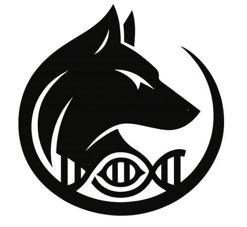

# Padfoot
<p>

<b>Padfoot</b> annotates somatic structural variants (SVs) from <a href="https://github.com/KolmogorovLab/Severus">Severus</a> and copy number from <a href="https://github.com/KolmogorovLab/Wakhan">Wakhan</a>. For every SV it reports the genes at each breakend, the consequence class and a tier; for every protein-coding gene it reports the SVs affecting each haplotype and the gene's copy-number status.
</p>

<br/>

## Contents

* [Installation](#installation)
* [Quick usage](#quick-usage)
* [Options](#options)
* [How SVs are annotated](#how-svs-are-annotated)
* [Copy number](#copy-number)
* [Output files](#output-files)
* [Bundled annotation](#bundled-annotation)
* [Tests](#tests)

## Installation

Clone the repository and create the conda environment:

```
git clone https://github.com/KolmogorovLab/Padfoot.git
cd Padfoot
conda env create --name padfoot --file environment.yml
conda activate padfoot
./padfoot.py --help
```

or install the `padfoot` command into the environment with `pip install .`.

External tools used: `samtools`, `minimap2`, `bedtools` (required) and
`RepeatMasker` (only with `--repeatmasker-species`). All are in `environment.yml`.

## Quick usage

```
padfoot --severus-vcf severus_somatic.vcf \
        --wakhan-profile wakhan/<solution>/integer_profile.bed \
        --ref GRCh38.fa --sex female --out-dir padfoot_out -t 16
```

`--wakhan-profile` is the `integer_profile.bed` of the Wakhan (≥ 0.5.0) solution
you have chosen; Padfoot does not choose between solutions.

## Options

**Required**

| Option | |
|---|---|
| `--severus-vcf` | Severus somatic VCF |
| `--wakhan-profile` | Wakhan `integer_profile.bed` (≥ 0.5.0) of the chosen solution |
| `--ref`, `-r` | reference FASTA, indexed with `samtools faidx` |
| `--out-dir` | output directory |

**Recommended**

| Option | Default | |
|---|---|---|
| `--sex` | `unknown` | `female`, `male` or `unknown`. No LOH is called on chrX of male samples; `unknown` is treated as female, with a warning |
| `--genome` | `hg38` | assembly of `--ref`; selects the bundled gene, RepeatMasker and cancer gene files (bundled: `hg38`, `mm10`). Padfoot warns if the chr1 length of `--ref` does not match |
| `--repeatmasker-species` | not run | run RepeatMasker on inserted sequences with this `-species` (e.g. `human`, `mouse`) |
| `-t`, `--threads` | 8 | threads for minimap2 / samtools |

**Optional**

| Option | Default | |
|---|---|---|
| `--gff` | bundled for `--genome` | gene annotation: a GENCODE/Ensembl-style GFF3 (converted with the same rules as the bundled files) or a table made by `scripts/build_annotation.py` |
| `--rm` | bundled for `--genome` | RepeatMasker annotation (`.fa.out`), used for the breakend repeat columns |
| `--cancer-genes` | bundled for `--genome` | cancer gene list (TSV with `Gene_symbol`, `Role_in_cancer`, `fusion`), or `none` |
| `--whole-gene-max-sv` | 1000000 | label genes lying entirely inside a DEL/DUP/INV up to this length |
| `--gain-high-multiplier` | 3 | `GAIN_HIGH` when a gene's total CN exceeds this multiple of the modal CN |

## How SVs are annotated

**Genes at a breakend.** Each protein-coding gene is padded by 10 kb on both
sides. A breakend is located on the gene's naming transcript (MANE Select,
else Ensembl canonical, else the longest CCDS transcript): in an exon (coding or
UTR-only), in an intron, or in the padding (`promoter/utr`). When several genes
overlap a breakend, the **primary** gene is a gene whose body contains it, then
one also hit by the other breakend, then the shortest gene; the others are
listed in `Other_genes1/2`. Every overlapping gene still gets the SV in
`by_gene.tsv` and `gene_sv_pairs.tsv`.

**Classes** (per SV from the primary genes, and per gene in `gene_sv_pairs.tsv`):

| Class | Breakends |
|---|---|
| `exon_altering` | both in the same exon (length a multiple of 3) |
| `frameshift` | both in the same exon, length not a multiple of 3 (for INS, the inserted length) |
| `between_exons` | in different exons/introns of the same gene |
| `intronic` | both in the same intron |
| `promoter/UTR` | both in the same-side padding |
| `possible_fusion` | in the bodies of two different genes, orientation compatible with a fusion; partners reported 5′::3′ |
| `oncogenic_fusion` | a `possible_fusion` listed as a known fusion in the cancer gene list (either orientation) |
| `between_genes` | in two different genes, not a fusion |
| `Gene-NonCoding` | one end in a gene, the other outside any gene |

**Tiers** (`HIGH` / `MODERATE`) depend on the class, where the breakend lies and
the SV type, never on cancer-gene status:

| Class | Situation | Tier |
|---|---|---|
| `exon_altering`, `frameshift` | coding exon | HIGH |
| `exon_altering`, `frameshift` | UTR-only exon | MODERATE |
| `between_exons` | | HIGH (none if the two ends are in opposite-side padding, i.e. the whole gene lies between them) |
| `possible_fusion`, `oncogenic_fusion` | | HIGH |
| `between_genes`, `Gene-NonCoding` | breakend in the gene body (not DUP) | HIGH |
| `between_genes`, `Gene-NonCoding` | gene reached only through the padding, or a DUP with one end in the gene | MODERATE |
| `intronic`, `promoter/UTR` | | MODERATE |

An SV's tier is the most severe over its genes; a gene's tier on each
haplotype is the most severe over its SVs.

**Labels** (no tier): `whole_gene_deletion` / `_duplication` / `_inversion` for a
gene lying entirely inside a DEL/DUP/INV of ≤ `--whole-gene-max-sv`;
`alt_isoform_exon` when a breakend outside the naming transcript's exons is in
an exon of another kept transcript; cancer role and known fusion from the
cancer gene list.

Single breakends and insertions have both breakends at the same position.

## Copy number

Padfoot reads the HP1/HP2 integer CN of each fragment from the Wakhan profile
(columns found from its `#chr` header). A haplotype with coverage, CN and
confidence all 0 (filled in by Wakhan's merge step) is treated as missing, not as
CN 0. Padfoot warns about chromosomes or regions the profile does not cover.

**Modal CN** is the integer total CN covering the most autosomal length; every
gene status is relative to it.

| `cn_status` | Rule (over the gene body; first match) |
|---|---|
| `HOMDEL` | min total CN = 0 |
| `GAIN_HIGH` | max total CN > `--gain-high-multiplier` × modal |
| `LOSS` | min total CN < modal |
| `GAIN` | max total CN > modal |
| `NEUTRAL` | otherwise |

**LOH**: one haplotype at CN 0 and total > 0; `LOH_type` is `with_loss`,
`copy_neutral` or `with_gain` from the lowest total CN among the LOH fragments,
relative to modal. No LOH on chrY, nor on chrX of male samples. Copy number
never changes an SV tier.

## Output files

All files are tab-separated. Empty fields are blank (some v0.1 columns write a single space).

### `annotated_svs.tsv` — one row per SV

| Column | |
|---|---|
| `SV ID` | Severus ID (BND mates as `<id>_1`) |
| `chr_1`, `pos_1`, `chr_2`, `pos_2` | breakends |
| `N_supp`, `Vaf` | supporting reads and VAF from Severus |
| `Strand` | Severus strands of the two breakends |
| `Impact` | SV tier (HIGH / MODERATE / blank) |
| `Role in Cancer1`, `Gene Name1`, `Pos_1`, `Strand_1` | primary gene at breakend 1: cancer role, name, location (`exon<n>`, `intron<n>`, `promoter/utr`), gene strand |
| `Repeat_Anno1` | RepeatMasker class within 5 bp of breakend 1 |
| `Role in Cancer2` … `Repeat_Anno2` | the same for breakend 2 |
| `Type` | SV class |
| `Microhomology` | shared sequence at the junction (±25 bp of reference around each breakend) |
| `VNTR` | Severus `INSIDE_VNTR` |
| `Telomere_repeat` | number of telomeric hexamers in the inserted sequence (≥ 4) |
| `Aligned_pos(INS)` | where the inserted sequence aligns (minimap2, MAPQ > 45) |
| `Repeat_annot` | RepeatMasker class covering > 80 % of the inserted sequence (`--repeatmasker-species` only) |
| `Other_genes1`, `Other_genes2` | other genes at each breakend (body or padding) |
| `fusion_partners` | 5′::3′ for fusion classes |
| `known_fusion` | yes / no |
| `whole_gene_labels` | e.g. `whole_gene_deletion:GENEC,GENED` |
| `alt_isoform_exon` | genes with an `alt_isoform_exon` hit |
| `cluster_id`, `detailed_type` | Severus `CLUSTERID` (clusters of ≥ 2 SVs) and `DETAILED_TYPE` |
| `haplotype` | `HP1` / `HP2` from the phased breakend(s), `HP0` if unphased, `HP1\|HP2` if the breakends disagree |

### `by_gene.tsv` — one row per protein-coding gene

| Column | |
|---|---|
| `Gene Name`, `Gene Pos` | symbol and gene span |
| `Role in Cancer` | from the cancer gene list |
| `HP1 Impact`, `HP1 SV` | most severe tier on HP1 and the SVs, each as `tier:[SV ID,position,class]` (fusions also give the partners) |
| `HP2 Impact`, `HP2 SV` | the same for HP2 |
| `Unphased annot`, `Unphased SV` | the same for unphased breakends |
| `gene_id` | GENCODE gene ID (rows are per gene ID, so genes sharing a symbol, e.g. PAR genes, get separate rows) |
| `n_SVs` | distinct SVs affecting the gene |
| `in_cluster` | yes if one of them has a Severus `CLUSTERID` |
| `HP1_CN_min/max`, `HP2_CN_min/max`, `total_CN_min/max` | CN range over the gene body |
| `modal_CN`, `cn_status` | see [Copy number](#copy-number) |
| `LOH`, `LOH_type` | yes / no and the LOH type |
| `cn_boundary_in_gene` | yes if the gene spans a CN change |
| `cn_missing` | yes if part of the gene has no CN call |

The haplotype of an SV for a gene is that of the breakend(s) in the gene.

### `gene_sv_pairs.tsv` — one row per (gene, SV)

| Column | |
|---|---|
| `gene`, `gene_id`, `gene_pos` | the gene |
| `sv_id`, `sv_type` | the SV |
| `haplotype` | haplotype(s) of the breakend(s) in this gene (0 = unphased) |
| `class`, `tier` | class and tier of the SV for this gene |
| `bp1_location`, `bp2_location` | `coding_exon<n>`, `utr_exon<n>`, `intron<n>`, `upstream_padding` / `downstream_padding` (outside the naming transcript), blank if that breakend is not in the gene |
| `fusion` | 5′::3′ for fusion classes |
| `labels` | `whole_gene_*`, `alt_isoform_exon` |

`padfoot.log` records the inputs, the annotation sources and their md5, the
modal CN and any coverage warnings. Intermediate files are in `temp/`.

## Bundled annotation

`beds/` contains the gene annotation (GENCODE v50 for hg38, vM25 for mm10),
RepeatMasker tracks and the hg38 cancer gene list. Sources, md5 sums and build
rules are in [`beds/README.md`](beds/README.md).

## Tests

```
pytest
```

## License

Padfoot is distributed under a BSD license. See the [LICENSE file](LICENSE) for details.

## Credits

Padfoot was developed by the Kolmogorov Lab at the National Cancer Institute as part of ongoing efforts to improve interpretation of long-read somatic variant data in cancer genomics.

Key contributors:

* Ayse Keskus
* Mikhail Kolmogorov

### Contact

For advising, bug reporting and requiring help, please submit an [issue](https://github.com/KolmogorovLab/Padfoot/issues).
You can also contact the developer: aysegokce.keskus@nih.gov
